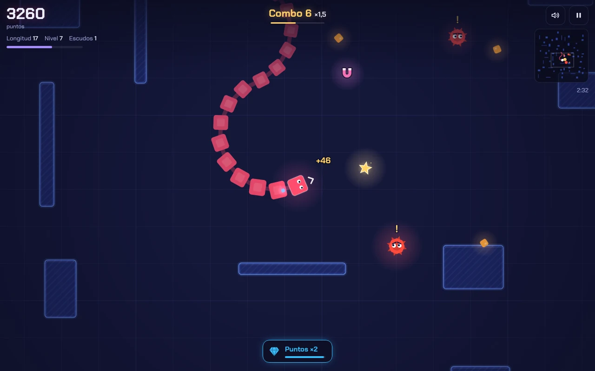
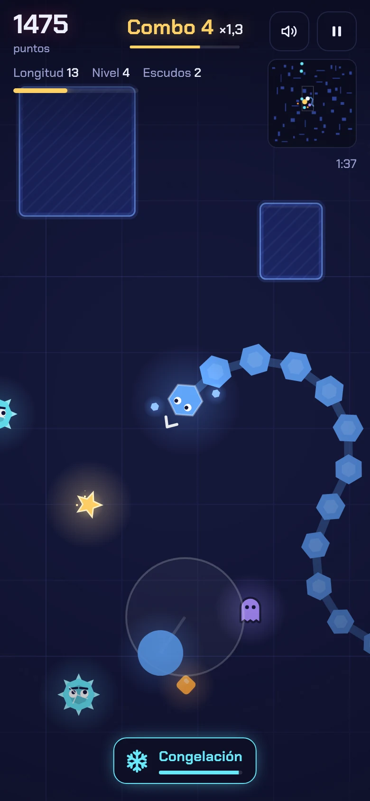
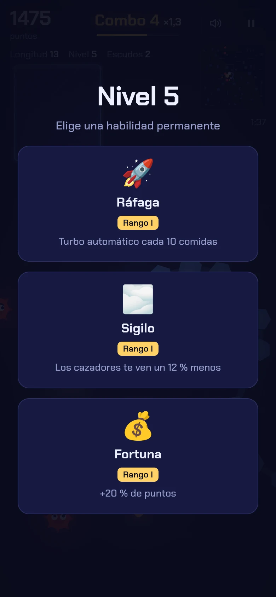
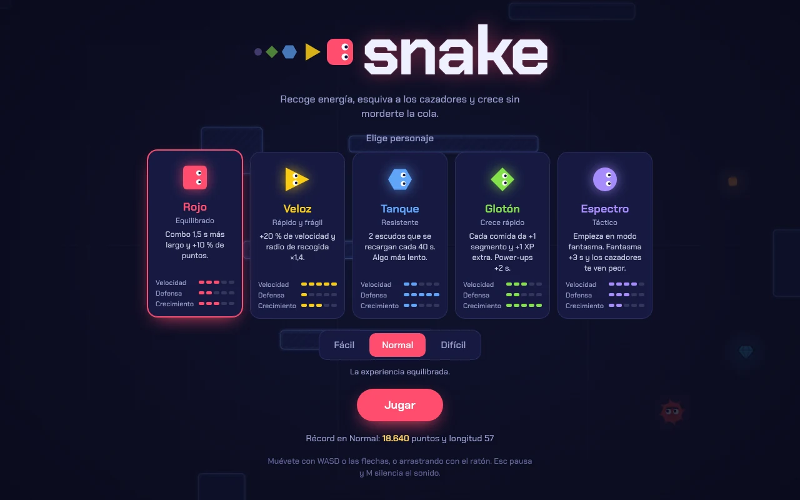

# Snake Joystick

Un snake arcade para móvil y escritorio. Mueves la serpiente con un joystick que aparece allí donde tocas la pantalla, recoges energía para crecer y esquivas a los cazadores, que te persiguen en cuanto te ven.

**[Jugar en el navegador](https://elcybercurioso.github.io/snake/)**



<p align="center">
  
  &nbsp;
  
</p>

## Cómo se juega

- Recoge los cubos naranjas: cada uno añade un segmento a la cola y da puntos y experiencia.
- Encadena comidas antes de que se agote la barra del combo. Cada comida seguida sube el multiplicador de puntos, hasta ×4.
- De vez en cuando aparece una estrella dorada lejos de ti. Una flecha en el borde de la pantalla indica dónde está. Vale mucho más que la comida normal, pero desaparece a los 10 segundos.
- La partida termina si chocas contra un muro, te muerdes la cola o un cazador te toca a ti o a tu cola.
- Cada 5 niveles eliges una habilidad permanente entre tres.

### Controles

| Acción | Móvil | Escritorio |
|---|---|---|
| Moverse | Arrastra en cualquier punto; el joystick aparece bajo el dedo | WASD, flechas o arrastrar con el ratón |
| Pausa | Botón de pausa | `Esc` o `P` |
| Sonido | Botón del altavoz | `M` |
| Elegir habilidad | Toca una tarjeta | `1`, `2` o `3` |

En marcha no puedes dar media vuelta en seco: un giro de 180° se convierte en una curva, para que un toque accidental no te haga morderte la cola. Desde parado sí puedes encarar cualquier dirección, así que vigila dónde está tu cola antes de arrancar.

### Personajes



| Personaje | Forma | Ventaja |
|---|---|---|
| Rojo | Cuadrado | El combo dura 1,5 s más y da un 10 % más de puntos |
| Veloz | Triángulo | Un 20 % más rápido y con un radio de recogida ×1,4 |
| Tanque | Hexágono | Dos escudos que se recargan cada 40 s, a cambio de ir un 12 % más lento |
| Glotón | Rombo | Cada comida da un segmento y 1 XP extra; sus power-ups duran 2 s más |
| Espectro | Círculo | Empieza 9 s en modo fantasma, su fantasma dura 3 s más y los cazadores lo ven un 15 % peor |

Un escudo absorbe cualquier choque, ya sea contra un muro, un cazador o tu propia cola: rebotas, el cazador que te ha tocado sale despedido y aturdido, y tienes un instante de invulnerabilidad.

### Power-ups

| Power-up | Efecto | Duración |
|---|---|---|
| Turbo | Velocidad ×1,6 | 5 s |
| Fantasma | Atraviesas muros, cazadores y tu propia cola | 5 s |
| Congelación | Congela a los cazadores; si los tocas, los rompes y ganas puntos | 4 s |
| Imán | Atrae la comida cercana y amplía el radio de recogida | 6 s |
| Puntos ×2 | Cada comida vale el doble | 8 s |
| Recorte | Quita tres segmentos de cola, útil cuando te quedas sin espacio | Inmediato |

### Cazadores

Patrullan el mapa al azar. Si entras en su radio de visión y no hay un muro de por medio, avisan con un «!» y van a por ti. Cuando les das esquinazo, buscan en el último sitio donde te vieron y, si no te encuentran, vuelven a patrullar. Una flecha roja en el borde de la pantalla avisa de los que te persiguen sin estar a la vista.

Cada dos niveles aparece un cazador más, y todos se vuelven algo más rápidos según avanzas.

### Habilidades

Se eligen en los niveles 5, 10, 15, 20… y su rango crece con el nivel: rango I en el 5, II en el 10, III en el 15 y IV a partir del 20. Si eliges una habilidad que ya tienes, su efecto se suma al anterior; en Recarga y Ráfaga se conserva el mejor intervalo.

<details>
<summary>Ver todas las habilidades</summary>

| Habilidad | Efecto |
|---|---|
| Turbina | +8 % de velocidad por rango |
| Atracción | +25 % de radio de recogida por rango |
| Blindaje | Un escudo más por rango |
| Recarga | Recupera un escudo cada 45 s, 8 s menos por rango (mínimo 15 s) |
| Persistencia | Los power-ups duran 1,5 s más por rango |
| Poda de emergencia | Una carga por rango: un choque mortal te quita cinco segmentos en lugar de acabar la partida |
| Aprendizaje | 1 XP más por comida y rango |
| Sigilo | Los cazadores te ven un 12 % peor por rango (hasta un 60 %) |
| Ráfaga | Turbo automático cada 12 comidas, dos menos por rango (mínimo 4) |
| Fortuna | +20 % de puntos por rango |
| Ritmo | El combo dura 1 s más por rango |

</details>

### Dificultad

| | Fácil | Normal | Difícil |
|---|---|---|---|
| Cazadores al empezar | 2 | 3 | 5 |
| Cazadores como máximo | 6 | 9 | 13 |
| Velocidad y visión de los cazadores | Menores | Base | Mayores |
| Experiencia para subir de nivel | 10 % menos | Base | 15 % más |

El récord se guarda en el navegador, uno por dificultad.

## Publicar en GitHub Pages

El juego son archivos estáticos: no hay que compilar nada.

1. Sube el contenido de este repositorio a la rama `main`.
2. En GitHub, abre **Settings › Pages**.
3. En **Build and deployment**, elige **Deploy from a branch**, la rama `main` y la carpeta `/ (root)`, y pulsa **Save**.
4. En uno o dos minutos el juego estará disponible en `https://elcybercurioso.github.io/snake/`.

## Probar en local

Desde la carpeta del repositorio:

```bash
python3 -m http.server 8000
```

Después abre <http://localhost:8000>. Abrir `index.html` con doble clic también funciona, pero el navegador bloquea la precarga de la tipografía desde `file://` y lo avisa en la consola.

## Estructura

```
.
├── index.html             Estructura de la página y de las pantallas
├── css/style.css          Estilos y tipografía
├── js/game.js             Lógica del juego, dibujo en canvas y sonido
├── manifest.webmanifest   Permite instalarlo en la pantalla de inicio del móvil
├── assets/
│   ├── fonts/             Chakra Petch y su licencia
│   └── icons/             Favicon e iconos de la aplicación
└── screenshots/           Imágenes de este README y vista previa para redes
```

No hay dependencias ni recursos externos: los gráficos se dibujan en canvas, el sonido se sintetiza con Web Audio y la tipografía va incluida en el repositorio. La página declara una Content Security Policy que solo permite cargar recursos del propio sitio e impide que el código abra conexiones de red (`fetch`, WebSocket…).

## Desarrollo

- **Panel de pruebas.** Se abre con `Shift + A` o con cinco toques seguidos sobre el título del menú o de la pausa. Permite jugar sin morir, ver hitboxes y radios de visión, subir de nivel, activar power-ups y ajustar velocidades. Las partidas en las que se usa no guardan récord.
- **Pruebas automatizadas.** Con `index.html?debug` el juego expone `window.__snake` para controlarlo desde scripts.

## Créditos y licencia

El código se distribuye bajo la licencia MIT; consulta [LICENSE](LICENSE).

La tipografía [Chakra Petch](https://github.com/m4rc1e/Chakra-Petch) es obra de The Chakra Petch Project Authors y se distribuye bajo la SIL Open Font License 1.1; consulta [assets/fonts/OFL.txt](assets/fonts/OFL.txt).
